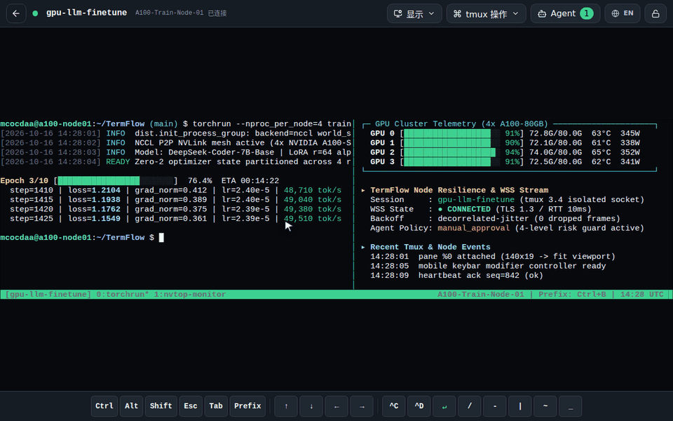

<div align="center">

# TermFlow

支持浏览器、移动端与原生客户端的安全远程 tmux 终端与四级风控 Agent Broker 控制平面。

[](https://github.com/mcocdaa)
[](https://github.com/mcocdaa/TermFlow/actions/workflows/ci.yml)
[](https://github.com/mcocdaa/TermFlow/releases)
[](https://www.python.org/)
[](https://www.typescriptlang.org/)
[](deploy/compose.yaml)
[](LICENSE)

[English](README.md) · [简体中文](README_CN.md)



</div>

## ✨ 核心特性

- **单向出站 Node A（`Computer → Term → Window → Pane`）**：计算节点 A 无需开放任何入站端口，仅通过 TLS/WSS 主动连接控制平面 B（`A 主动连接 B`，`A 不开放端口`）；关闭客户端或网络闪断绝不中断正在运行的 `tmux` 任务。
- **移动优先的终端交互体验**：基于 `xterm.js` 的响应式工作区，内置触控友好的 `MobileKeyBar`（`Esc`、`Tab`、`Ctrl`、`Alt`、方向键及 `tmux` 组合快捷键）与 7 套极客终端主题。
- **内置四级风控 Agent Broker（`OpenCode`）**：提供可回放的 Agent 事件流与四级风险评估守卫，任何写入或高危终端操作均强制执行人工审批确认（Human-in-the-Loop）。
- **TOTP 双因素认证与一次性配对**：支持 TOTP 动态口令保护、短效一次性节点注册码，以及移动端扫码或配对码远程授权。
- **全平台原生客户端**：基于 Vue 3 + TypeScript + Tauri 2 共用核心构建，覆盖 Web、Windows、Linux、macOS、Android 与 iOS Simulator。
- **严格的控制平面安全边界**：控制平面 B 仅负责认证、状态同步与终端流转发，不执行宿主机命令，由节点 A 保持真实终端进程的唯一权威。

## 🚀 快速开始

### 1. 部署 Control Plane B + Web C + Agent Broker（Docker Compose）

**方式一：使用已发布镜像（推荐生产使用）**

```bash
TAG=v0.2.0
BASE="https://raw.githubusercontent.com/mcocdaa/TermFlow/${TAG}"
mkdir -p termflow && cd termflow
curl -fsSLO "${BASE}/deploy/compose.release.yaml"
curl -fsSLO "${BASE}/deploy/opencode-config.yaml"
curl -fsSLo .env "${BASE}/.env.example"
chmod 0600 .env

# 按 .env 注释配置 TERMFLOW_ADMIN_TOKEN、OPENCODE_SERVER_*、OPENCODE_AGENT_MCP_TOKEN、
# DEEPSEEK_API_KEY，并将 TERMFLOW_RELEASE_IMAGE_TAG 设为 ${TAG}
docker compose --env-file .env -f compose.release.yaml up -d
curl -fsS http://127.0.0.1:8765/healthz
```

**方式二：从源码本地构建启动**

```bash
cp .env.example .env
docker compose --env-file .env -f deploy/compose.yaml up -d --build
curl -fsS http://127.0.0.1:8765/healthz
```

### 2. 安装并注册 Linux 节点 A（需 `tmux 3.2+`）

```bash
curl -fsSL \
  https://github.com/mcocdaa/TermFlow/releases/download/v0.1.0/install-termflow-node.sh \
  | bash

termflow login \
  --server https://termflow.example.com \
  --code '<Web C 生成的一次性注册码>'

termflow new --name project-a
```

按 `Ctrl+B` 再按 `D` 可随时退出当前视图且后台保持运行，使用 `termflow attach project-a` 重新进入。

<details>
<summary>📦 Standalone Control Plane, Offline Tarball & Packaging Reference</summary>

### 单容器 Control Plane B（仅终端转发，不含 Agent 运行时）

当仅需远程终端而不需要 OpenCode Agent 时（`B 的 Web/API 通过宿主机 loopback 端口发布；A 主动连接 B，是连接 B 的客户端，不是 B 的网关；A 不开放端口`）：

```bash
mkdir -p data totp-secrets
docker network create termflow-net

docker run -d --name termflow-control-plane \
  --restart unless-stopped \
  --network termflow-net \
  --publish 127.0.0.1:8765:8000 \
  --volume "$PWD/data:/app/data" \
  --volume "$PWD/totp-secrets:/app/totp-secrets" \
  --env TERMFLOW_ADMIN_TOKEN='<至少 32 字节的管理员 token>' \
  --env TERMFLOW_DATABASE_URL=sqlite+aiosqlite:////app/data/termflow.db \
  --env TERMFLOW_PUBLIC_BASE_URL=https://termflow.example.com \
  --env TERMFLOW_ALLOW_INSECURE_LOOPBACK="${TERMFLOW_ALLOW_INSECURE_LOOPBACK:-true}" \
  --env TERMFLOW_TOTP_AUTO_MASTER_KEY_FILE=/app/totp-secrets/totp-master-key \
  ghcr.io/mcocdaa/termflow-control-plane:v0.2.0

curl -fsS http://127.0.0.1:8765/healthz
```

离线镜像导入与 TOTP 重置命令：

```bash
docker load -i termflow-control-plane.tar
docker exec termflow-control-plane termflow-control auth totp reset
```

### 容器化运行节点 A（Docker）

先在 Web C 或通过 API（`POST /api/v1/enrollment-tokens`）生成一次性注册码，再将 `termflow-node` 加入与 B 相同的普通 bridge 网络启动：

```bash
mkdir -p termflow-node-identity termflow-node-work

docker run -d \
  --name termflow-node \
  --restart unless-stopped \
  --network termflow_default \
  --cap-drop ALL \
  --cap-add CHOWN \
  --cap-add DAC_OVERRIDE \
  --cap-add SETUID \
  --cap-add SETGID \
  --security-opt no-new-privileges:true \
  --read-only \
  --tmpfs /tmp \
  --volume "$PWD/termflow-node-identity:/home/termflow" \
  --volume "$PWD/termflow-node-work:/work" \
  --env TERMFLOW_SERVER=http://control-plane:8000 \
  --env TERMFLOW_CODE='<一次性注册码>' \
  --env TERMFLOW_ALLOW_INSECURE_HTTP=true \
  --env TERMFLOW_NEW=demo \
  ghcr.io/mcocdaa/termflow-node:v0.2.0
```

进入容器内终端或执行诊断（需指定容器内 UID 1000 `termflow` 用户）：

```bash
docker exec --user termflow -it termflow-node termflow attach demo
docker exec --user termflow termflow-node termflow doctor
docker exec --user termflow termflow-node termflow status demo --json
```

### 构建版本与打包发布契约

- **版本号解析优先级**：`Git Tag > TERMFLOW_BUILD_VERSION > 0.2.0-dev.0`
- **发布工作流与制品**（支持 `workflow_dispatch`、`workflow_call`、`Actions artifact`、`GitHub Release`、`GHCR`）：
  - `Package A · Linux Node`（`termflow-node-linux-x86_64`，要求 `tmux 3.2`+，通过 `Path.cwd().as_uri()` 进行离线 wheel 安装）
  - `Package B + Web C · Control Plane`（固定 `Node 22.23.2` 与 Python 3.12 运行时）
  - `Package C · Native Clients`（Windows、Linux、macOS、Android 与 iOS Simulator 客户端，可在 [GitHub Releases](https://github.com/mcocdaa/TermFlow/releases) 下载）

</details>

## 📚 文档导航

| 文档 | 说明 |
| --- | --- |
| [docs/architecture.md](docs/architecture.md) | 架构与进程边界：Node A、Control Plane B、Web C 与 OpenCode 的网络及权限模型 |
| [docs/protocol.md](docs/protocol.md) | 协议契约：Node A 与 Control Plane B 之间的版本化 WebSocket 消息协议 |
| [docs/security.md](docs/security.md) | 安全与隐私：TOTP 双因素认证、一次性配对码、Agent 四级风控与容器加固 |
| [docs/api-examples.md](docs/api-examples.md) | API 示例：节点注册、终端会话、窗格控制与 Agent 审批接口示例 |
| [docs/web-client.md](docs/web-client.md) | Web C 指南：桌面与移动端终端界面、扫码授权、主题切换与 `MobileKeyBar` |
| [docs/operations.md](docs/operations.md) | 部署与恢复：生产环境部署、版本升级、数据卷备份与 TOTP 恢复流程 |
| [docs/github-actions.md](docs/github-actions.md) | 构建与发布：CI/CD 流水线、多平台安装包构建矩阵与 GHCR 镜像发布 |
| [docs/troubleshooting.md](docs/troubleshooting.md) | 排障指南：`tmux` 独立 Socket、WebSocket 握手及容器权限常见问题排查 |
| [docs/superpowers/README.md](docs/superpowers/README.md) | 设计与实施记录：架构演进规格说明与工程实施档案 |

## 📄 许可证

本项目基于 [MIT License](LICENSE) 开源。
